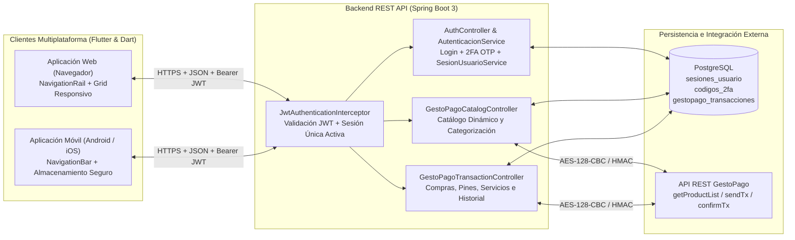

# Documentación Técnica: Ecosistema de Comercio Digital mediante Integración de Servicios REST (GestoPago)

**Unidad II — Desarrollo de Aplicaciones Móviles**

---

## 1. Arquitectura General del Ecosistema

El ecosistema de comercio digital está compuesto por una **Aplicación Web** y una **Aplicación Móvil** construidas sobre una arquitectura desacoplada en **Flutter & Dart**, conectadas a una única infraestructura de servicios REST en **Spring Boot (Java 17)**, respaldada por **PostgreSQL** e integrada en tiempo real con los servicios transaccionales de **GestoPago**.



### 1.1 Separación de Responsabilidades (Clean Architecture & SOLID)

- **Capa de Presentación (`lib/screens/` y `lib/theme/`):**
  - [`login_screen.dart`](../mobile-flutter/lib/screens/login_screen.dart): Inicio de sesión adaptable entre Web y Móvil, selector de plataforma para demostración y diálogo de resolución de conflicto de sesión (`409 Conflict`).
  - [`two_factor_screen.dart`](../mobile-flutter/lib/screens/two_factor_screen.dart): Verificación de segundo factor (2FA OTP de 6 dígitos) con temporizador y reenvío.
  - [`home_shell_screen.dart`](../mobile-flutter/lib/screens/home_shell_screen.dart): Contenedor responsivo con `NavigationRail` lateral en Web/Escritorio y `NavigationBar` inferior en Móvil.
  - [`catalog_screen.dart`](../mobile-flutter/lib/screens/catalog_screen.dart): Exploración dinámica del catálogo de GestoPago con buscador, filtros por tipo de servicio/operador y modal de detalle.
  - [`purchase_screen.dart`](../mobile-flutter/lib/screens/purchase_screen.dart): Flujo transaccional con modal de confirmación previa y pantalla de resultado semántico (`EXITOSA`, `RECHAZADA`, `PENDIENTE`, `ERROR_COMUNICACION`).
  - [`history_screen.dart`](../mobile-flutter/lib/screens/history_screen.dart): Historial sincronizado que muestra exclusivamente compras con estado `EXITOSA` y permite verificar cada operación por `UPC`.
- **Capa de Estado (`lib/state/`):**
  - [`session_controller.dart`](../mobile-flutter/lib/state/session_controller.dart): Administra el ciclo de vida de la sesión autenticada, el reto 2FA, los conflictos de concurrencia (`409`) y el cierre automático ante revocación o expiración (`401`).
- **Capa de Servicios (`lib/services/`):**
  - [`auth_service.dart`](../mobile-flutter/lib/services/auth_service.dart), [`catalog_service.dart`](../mobile-flutter/lib/services/catalog_service.dart) y [`transaction_service.dart`](../mobile-flutter/lib/services/transaction_service.dart).
- **Capa de Red y Almacenamiento Seguro (`lib/core/`):**
  - [`api_client.dart`](../mobile-flutter/lib/core/network/api_client.dart): Cliente HTTP centralizado con inyección automática de `Authorization: Bearer <token>`, control de timeouts y mapeo semántico de errores HTTP.
  - [`secure_session_storage.dart`](../mobile-flutter/lib/core/storage/secure_session_storage.dart): Persistencia cifrada mediante `FlutterSecureStorage`.

---

## 2. Mecanismos de Seguridad Implementados

1. **Autenticación de Doble Factor (2FA OTP) Validada en Servidor:**
   - Al validar correo y contraseña en `/auth/login/2fa/solicitar`, el servidor genera un código OTP numérico de 6 dígitos en la tabla `codigos_2fa` con expiración de 5 minutos.
   - El token JWT únicamente se emite tras validar y consumir el código OTP en `/auth/login/2fa/verificar`.
2. **Control de Sesión Única Activa entre Plataformas (`WEB` vs `MOVIL`):**
   - La tabla `sesiones_usuario` almacena la sesión activa del usuario junto con el `sessionId` (incluido como claim `jti` y `sessionId` en el JWT) y la plataforma (`WEB` o `MOVIL`).
   - Si el usuario tiene una sesión activa en `MOVIL` e intenta autenticarse en `WEB` con `forzarCierreSesion: false`, el backend responde con **`409 Conflict`** indicando la plataforma activa.
   - Si el usuario confirma el reemplazo (`forzarCierreSesion: true`), el backend marca como inactiva la sesión anterior e invalida inmediatamente el JWT previo en `JwtAuthenticationInterceptor`.
3. **Protección de Información y Cierre Seguro:**
   - Ninguna credencial ni secreto de GestoPago se almacena en el cliente.
   - Al cerrar sesión (`POST /auth/logout`) o al detectarse un código `401 Unauthorized`, el cliente limpia el almacenamiento seguro y redirige al login.

---

## 3. Catálogo de Servicios REST Consumidos

### 3.1 Solicitar Reto de Inicio de Sesión con 2FA
- **Método HTTP y URL:** `POST /auth/login/2fa/solicitar`
- **Parámetros requeridos:** Cuerpo JSON con credenciales, plataforma (`WEB` o `MOVIL`) y bandera `forzarCierreSesion`.
- **Estructura de Solicitud (Request JSON):**
  ```json
  {
    "correo": "ana.lopez.prueba@example.com",
    "password": "Prueba2026!",
    "plataforma": "MOVIL",
    "forzarCierreSesion": false
  }
  ```
- **Estructura de Respuesta Exitosa (`200 OK`):**
  ```json
  {
    "success": true,
    "message": "Credenciales válidas. Ingresa el código 2FA para completar el inicio de sesión.",
    "data": {
      "requiere2FA": true,
      "correo": "ana.lopez.prueba@example.com",
      "numeroCuenta": "4229215075268914",
      "plataforma": "MOVIL",
      "codigoOtp": "482910",
      "expiraEnSegundos": 300,
      "mensaje": "Se generó tu código de verificación de 6 dígitos."
    }
  }
  ```
- **Estructura de Respuesta en Conflicto de Sesión (`409 Conflict`):**
  ```json
  {
    "success": false,
    "message": "Ya existe una sesión activa en MOVIL.",
    "data": {
      "sesionActivaExistente": true,
      "plataformaActiva": "MOVIL",
      "fechaInicio": "2026-11-09T19:00:00Z",
      "fechaExpiracion": "2026-11-09T19:15:00Z",
      "accionRequerida": "Debes finalizar la sesión anterior en MOVIL antes de iniciar una nueva."
    }
  }
  ```
- **Códigos HTTP manejados:** `200 OK`, `400 Bad Request`, `401 Unauthorized`, `403 Forbidden`, `409 Conflict`.
- **Validaciones y tratamiento de errores:** Verifica formato de correo, vigencia de cuenta, bloqueo por intentos fallidos y existencia de sesión activa en otra plataforma.

---

### 3.2 Verificar Código 2FA y Emitir Sesión Única JWT
- **Método HTTP y URL:** `POST /auth/login/2fa/verificar`
- **Parámetros requeridos:** `correo`, `password`, `codigo2FA` (6 dígitos), `plataforma`, `forzarCierreSesion`.
- **Estructura de Solicitud (Request JSON):**
  ```json
  {
    "correo": "ana.lopez.prueba@example.com",
    "password": "Prueba2026!",
    "codigo2FA": "482910",
    "plataforma": "MOVIL",
    "forzarCierreSesion": true
  }
  ```
- **Estructura de Respuesta (`200 OK`):**
  ```json
  {
    "success": true,
    "message": "Inicio de sesión con 2FA exitoso",
    "data": {
      "accessToken": "eyJhbGciOiJIUzI1NiJ9...",
      "tokenType": "Bearer",
      "expiresIn": 900,
      "expiresAt": "2026-11-09T19:30:00Z",
      "sessionId": "8f1d4b90-4a9c-4d2e-9a11-7a99c1e02f11",
      "plataforma": "MOVIL",
      "clienteId": 1,
      "nombreCliente": "Ana María López García",
      "correo": "ana.lopez.prueba@example.com",
      "numeroCuenta": "4229215075268914",
      "saldoCuenta": 4990.00
    }
  }
  ```
- **Códigos HTTP manejados:** `200 OK`, `400 Bad Request` (OTP inválido o expirado), `401 Unauthorized`, `409 Conflict`.

---

### 3.3 Consultar Estado de Sesión Activa
- **Método HTTP y URL:** `GET /auth/sesion`
- **Parámetros requeridos:** Header `Authorization: Bearer <accessToken>`.
- **Estructura de Respuesta (`200 OK`):**
  ```json
  {
    "success": true,
    "message": "Sesión activa válida",
    "data": {
      "activa": true,
      "sessionId": "8f1d4b90-4a9c-4d2e-9a11-7a99c1e02f11",
      "plataforma": "WEB",
      "correo": "ana.lopez.prueba@example.com",
      "clienteId": 1,
      "nombreCliente": "Ana María López García",
      "numeroCuenta": "4229215075268914",
      "saldoCuenta": 4940.00
    }
  }
  ```
- **Códigos HTTP manejados:** `200 OK`, `401 Unauthorized` (cuando la sesión fue reemplazada desde otro dispositivo o expiró).

---

### 3.4 Cerrar Sesión Activa
- **Método HTTP y URL:** `POST /auth/logout` (alias `POST /api/auth/logout`)
- **Parámetros requeridos:** Header `Authorization: Bearer <accessToken>`.
- **Estructura de Respuesta (`200 OK`):**
  ```json
  {
    "success": true,
    "message": "Sesión cerrada correctamente",
    "data": {
      "sesionCerrada": true
    }
  }
  ```
- **Códigos HTTP manejados:** `200 OK`, `401 Unauthorized`.

---

### 3.5 Consultar Catálogo de Productos GestoPago
- **Método HTTP y URL:** `GET /api/gestopago/catalogo/productos` (y `GET /api/gestopago/catalogo/sincronizar`)
- **Parámetros requeridos:** Header `Authorization: Bearer <accessToken>`.
- **Estructura de Respuesta (`200 OK`):**
  ```json
  {
    "success": true,
    "message": "Catálogo obtenido desde base de datos local",
    "data": {
      "codigo": "01",
      "mensaje": "Catálogo local",
      "totalProductos": 45,
      "productos": [
        {
          "servicio": "Telcel",
          "idServicio": "1",
          "idCatTipoServicio": "1",
          "tipoServicio": "Tiempo Aire",
          "producto": "Recarga Telcel $50",
          "idProducto": "5",
          "precio": "50.00",
          "tipoFront": "1",
          "hasDigitoVerificador": "false",
          "leyenda": "Ingresa los 10 dígitos del número celular"
        }
      ]
    }
  }
  ```
- **Códigos HTTP manejados:** `200 OK`, `401 Unauthorized`, `502 Bad Gateway`, `504 Gateway Timeout`.

---

### 3.6 Realizar Compra de Producto (Recargas / Pagos de Servicio / Pines)
- **Método HTTP y URL:**
  - `POST /api/gestopago/transacciones/abonar` (`tipoFront = 1`)
  - `POST /api/gestopago/transacciones/pagar-servicio` (`tipoFront = 2`)
  - `POST /api/gestopago/transacciones/enviar-pin` (`tipoFront = 4`)
- **Parámetros requeridos:** Header `Authorization: Bearer <accessToken>` y cuerpo JSON con datos del producto y destino.
- **Estructura de Solicitud (Request JSON):**
  ```json
  {
    "idProducto": 5,
    "idServicio": 1,
    "nombreProducto": "Recarga Telcel $50",
    "telefono": "5512345678",
    "monto": 50.0,
    "numeroCuenta": "4229215075268914",
    "clienteId": 1
  }
  ```
- **Estructura de Respuesta (`200 OK`):**
  ```json
  {
    "success": true,
    "message": "Abono realizado exitosamente",
    "data": {
      "upc": "TX1A18913184248",
      "tipoOperacion": "RECARGA",
      "idProducto": 5,
      "idServicio": 1,
      "nombreProducto": "Recarga Telcel $50",
      "exitoso": true,
      "estado": "EXITOSA",
      "codigo": "01",
      "mensaje": "Operacion realizada con exito",
      "idTx": "826364546",
      "numAutorizacion": "18596434",
      "saldo": 1000.00,
      "monto": 50.00,
      "comision": 0.00,
      "saldoCliente": 4940.00,
      "telefono": "5512345678",
      "numeroCuenta": "4229215075268914",
      "fecha": "09/Nov/2026 19:35:00"
    }
  }
  ```
- **Códigos HTTP manejados y Clasificación de Estados:**
  - **Compra Exitosa (`EXITOSA`):** `exitoso == true` y `estado == "EXITOSA"` (Código GestoPago `01`).
  - **Compra Pendiente (`PENDIENTE`):** Código GestoPago `06`, activando verificación con `POST /api/gestopago/transacciones/confirmar`.
  - **Compra Rechazada (`RECHAZADA`):** Saldo insuficiente, referencia inválida o rechazo del proveedor (`exitoso == false`).
  - **Error de Comunicación (`ERROR_COMUNICACION`):** `502`, `503` o `504` sin confirmación del proveedor.

---

### 3.7 Consultar Historial de Compras Exitosas Asociadas al Usuario
- **Método HTTP y URL:** `GET /api/gestopago/transacciones/historial/exitosas` (alias `GET /api/gestopago/transacciones/mis-compras`)
- **Parámetros requeridos:** Header `Authorization: Bearer <accessToken>` y parámetros opcionales `clienteId` y `numeroCuenta`.
- **Estructura de Respuesta (`200 OK`):**
  ```json
  {
    "success": true,
    "message": "Historial de compras exitosas obtenido correctamente",
    "data": [
      {
        "upc": "TX1A18913184248",
        "tipoOperacion": "RECARGA",
        "idProducto": 5,
        "idServicio": 1,
        "nombreProducto": "Recarga Telcel $50",
        "exitoso": true,
        "estado": "EXITOSA",
        "codigo": "01",
        "mensaje": "Operacion realizada con exito",
        "idTx": "826364546",
        "numAutorizacion": "18596434",
        "monto": 50.00,
        "telefono": "5512345678",
        "numeroCuenta": "4229215075268914",
        "fecha": "09/Nov/2026 19:35:00"
      }
    ]
  }
  ```
- **Validaciones:** Filtra estrictamente en base de datos y en la capa de servicio del cliente aquellas operaciones cuyo estado sea **`EXITOSA`**, descartando intentos fallidos o pendientes.

---

### 3.8 Verificar Detalle de Transacción por UPC
- **Método HTTP y URL:** `GET /api/gestopago/transacciones/estado?upc={upc}`
- **Parámetros requeridos:** Header `Authorization: Bearer <accessToken>` y query param `upc`.
- **Códigos HTTP manejados:** `200 OK`, `400 Bad Request` (si el UPC no existe), `401 Unauthorized`.

---

## 4. Guía Paso a Paso: Escenario Práctico de Evaluación (Usuaria Ana)

### Credenciales de Prueba Configuradas
- **Usuaria:** Ana María López García
- **Correo:** `ana.lopez.prueba@example.com`
- **Contraseña:** `Prueba2026!`
- **Cuenta Asociada:** `4229215075268914`
- **Teléfono de Prueba:** `5512345678`

### Ejecución Paso a Paso

1. **Paso 1 — Inicio de sesión en la Aplicación Móvil:**
   - Abrir la aplicación en modo **Móvil (`MOVIL`)**.
   - Ingresar `ana.lopez.prueba@example.com` y `Prueba2026!` (o pulsar **Cargar credenciales de Ana**).
   - El sistema solicita el segundo factor (2FA) y genera el código OTP de 6 dígitos en el servidor.
   - Ingresar el código OTP y pulsar **Verificar e Ingresar**. Se registra la sesión activa en la plataforma `MOVIL`.

2. **Paso 2 — Consulta del Catálogo de Productos:**
   - En la pestaña **Catálogo**, Ana visualiza los productos de GestoPago organizados por categorías (**Tiempo Aire**, **Pago de Servicios**, **Pines Electrónicos**).
   - Seleccionar un producto disponible (por ejemplo, `Recarga Telcel $10` o `Recarga Telcel $50`).

3. **Paso 3 — Realización de una Compra Exitosa:**
   - Pulsar **Comprar este producto**, capturar el número `5512345678` y pulsar **Continuar a Confirmación**.
   - En el diálogo de confirmación previa, revisar el resumen y pulsar **Confirmar y Pagar**.
   - El sistema procesa la operación con GestoPago y muestra el comprobante con estado **`¡Compra Exitosa!`** (`EXITOSA`), folio `idTx`, código `UPC` y número de autorización.

4. **Paso 4 — Consulta del Historial en Móvil:**
   - Dirigirse a la pestaña **Historial**.
   - Verificar que la compra recién realizada aparece listada con su fecha y hora, producto adquirido, importe y referencia `idTx`/`UPC`.

5. **Paso 5 — Intento de Inicio de Sesión en la Aplicación Web (Detección de Sesión Simultánea):**
   - Abrir la aplicación en el navegador **Web (`WEB`)** e ingresar las mismas credenciales de Ana (`ana.lopez.prueba@example.com` / `Prueba2026!`).
   - El sistema detecta que Ana mantiene una sesión activa en **`MOVIL`** (`409 Conflict`) y despliega el diálogo **Sesión Activa Detectada**, informando que no se permiten dos sesiones simultáneas y solicitando confirmación para cerrar la sesión anterior.

6. **Paso 6 — Reemplazo de Sesión y Verificación Sincronizada en Web:**
   - Pulsar **Cerrar anterior y continuar** en la aplicación Web y completar el código 2FA.
   - El servidor invalida inmediatamente la sesión de `MOVIL` y activa la sesión de `WEB`.
   - En la aplicación Web, abrir el apartado **Historial**: Ana visualiza inmediatamente la compra realizada previamente desde la aplicación móvil.
   - Si se intenta realizar cualquier acción en la aplicación móvil anterior, ésta detecta el código `401` y cierra su sesión local mostrando el aviso de que la sesión fue reemplazada desde otro dispositivo.

