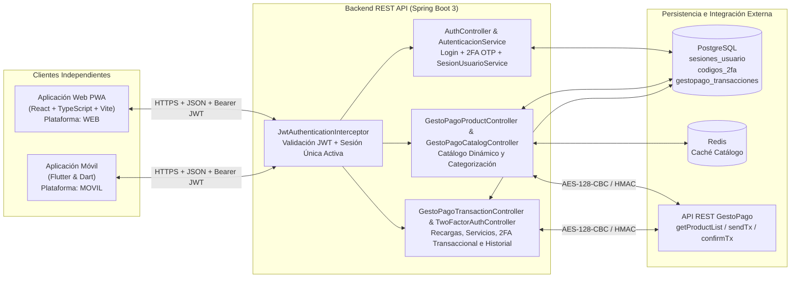

# Documentación Técnica: Ecosistema de Comercio Digital mediante Integración de Servicios REST (GestoPago)

**Unidad II — Desarrollo de Aplicaciones Móviles**

---

## 1. Arquitectura General del Ecosistema

El ecosistema de comercio digital está compuesto por **tres proyectos independientes** organizados en repositorios propios que comparten una única infraestructura de servicios REST en **Spring Boot 3 (Java 17)** sin duplicar lógica de negocio:

| Componente | Tecnología | Plataforma | Repositorio |
| :--- | :--- | :---: | :--- |
| **Backend API REST** | Spring Boot 3 + Java 17 + PostgreSQL + Redis | Servidor | [AppHasaniGestoPagos](https://github.com/RonaldoChavez76/AppHasaniGestoPagos) |
| **Aplicación Móvil** | Flutter & Dart | `MOVIL` | [gestopago-mobile-flutter](https://github.com/RonaldoChavez76/gestopago-mobile-flutter) |
| **Aplicación Web (PWA)** | React 19 + TypeScript + Vite 6 + Tailwind CSS v4 | `WEB` | [gestopago-web-react](https://github.com/RonaldoChavez76/gestopago-web-react) |



### 1.1 Separación de Responsabilidades en los Clientes

- **Aplicación Web PWA (`gestopago-web-react/src/`):**
  - `config/apiConfig.ts`: Selección de entorno (`Render Cloud` o `localhost:8080`) con plataforma fija `WEB`.
  - `core/network/apiClient.ts` y `core/storage/sessionStorageService.ts`: Cliente HTTP centralizado (`Authorization: Bearer`), manejo de `409 Conflict` / `401 Unauthorized` y almacenamiento en `sessionStorage`.
  - `context/SessionContext.tsx`: Estado global de sesión, reto 2FA y verificación automática ante foco de pestaña (`window.focus`) e intervalo periódico.
  - `services/`: `authService.ts`, `catalogService.ts` y `transactionService.ts`.
  - `pages/` y `components/`: `LoginPage`, `TwoFactorPage`, `AccountOverviewPage`, `CatalogPage`, `PurchasePage` y `HistoryPage`, junto con modales accesibles (`SessionConflictModal`, `ProductDetailModal`, `PurchaseConfirmModal`, `PurchaseResultReceiptCard`, `HistoryDetailModal`).
- **Aplicación Móvil (`gestopago-mobile-flutter/lib/`):**
  - `core/config/api_config.dart`, `core/network/api_client.dart` y `core/storage/secure_session_storage.dart`: Cliente HTTP y almacenamiento de sesión configurado por defecto para `MOVIL`.
  - `state/session_controller.dart`, `services/` y `screens/`: `LoginScreen`, `TwoFactorScreen`, `HomeShellScreen`, `CatalogScreen`, `PurchaseScreen` y `HistoryScreen`.

---

## 2. Mecanismos de Seguridad Implementados

1. **Autenticación de Doble Factor (2FA OTP) Validada en Servidor:**
   - Al validar correo y contraseña en `/auth/login/2fa/solicitar`, el servidor genera un código OTP numérico de 6 dígitos con vigencia de 5 minutos.
   - El token JWT únicamente se emite tras validar y consumir el código OTP en `/auth/login/2fa/verificar`.
   - Adicionalmente, durante la ejecución de compras, el usuario puede solicitar y validar un OTP transaccional mediante `/api/seguridad/2fa/solicitar`.
2. **Control de Sesión Única Activa entre Plataformas (`WEB` vs `MOVIL`):**
   - La tabla `sesiones_usuario` almacena la sesión activa del usuario junto con su `sessionId` (incluido como claim en el JWT) y la plataforma (`WEB` o `MOVIL`).
   - Si el usuario mantiene una sesión activa en `MOVIL` e intenta autenticarse en la Web React (`WEB`) con `forzarCierreSesion: false`, el backend responde con **`409 Conflict`** indicando en qué plataforma está activa la sesión.
   - Si el usuario confirma el reemplazo (`forzarCierreSesion: true`), el backend cierra la sesión anterior e invalida inmediatamente el JWT previo (`401 Unauthorized` en cualquier petición posterior del dispositivo desplazado).
3. **Protección de Información y Cierre Seguro:**
   - Ninguna credencial o llave de GestoPago se almacena en el código cliente.
   - Al cerrar sesión (`POST /auth/logout`) o detectarse `401 Unauthorized`, ambos clientes limpian el estado local y redirigen al inicio de sesión.

---

## 3. Catálogo de Servicios REST Consumidos

### 3.1 Solicitar Reto de Inicio de Sesión con 2FA
- **Método HTTP y URL:** `POST /auth/login/2fa/solicitar`
- **Parámetros requeridos:** Cuerpo JSON con `correo`, `password`, `plataforma` (`WEB` o `MOVIL`) y `forzarCierreSesion`.
- **Estructura de Solicitud (Request JSON):**
  ```json
  {
    "correo": "ana.lopez.prueba@example.com",
    "password": "Prueba2026!",
    "plataforma": "MOVIL",
    "forzarCierreSesion": false
  }
  ```
- **Estructura de Respuesta Exitosa (`200 OK`):**
  ```json
  {
    "success": true,
    "message": "Credenciales válidas. Ingrese el código de verificación de doble factor (2FA) de 6 dígitos para iniciar sesión.",
    "data": {
      "requiere2FA": true,
      "correo": "ana.lopez.prueba@example.com",
      "numeroCuenta": "4229215075268914",
      "plataforma": "MOVIL",
      "codigoOtp": "482910",
      "expiraEnSegundos": 300,
      "mensaje": "Código OTP generado."
    }
  }
  ```
- **Estructura de Respuesta en Conflicto de Sesión (`409 Conflict`):**
  ```json
  {
    "success": false,
    "message": "Ya existe una sesión activa en MOVIL.",
    "data": {
      "sesionActivaExistente": true,
      "plataformaActiva": "MOVIL",
      "fechaInicio": "2026-11-22T01:00:00Z",
      "fechaExpiracion": "2026-11-22T01:15:00Z",
      "accionRequerida": "Debes finalizar la sesión anterior en MOVIL antes de iniciar una nueva."
    }
  }
  ```
- **Códigos HTTP manejados:** `200 OK`, `400 Bad Request`, `401 Unauthorized`, `403 Forbidden`, `409 Conflict`.

---

### 3.2 Verificar Código 2FA y Emitir Sesión Única JWT
- **Método HTTP y URL:** `POST /auth/login/2fa/verificar`
- **Estructura de Solicitud (Request JSON):**
  ```json
  {
    "correo": "ana.lopez.prueba@example.com",
    "password": "Prueba2026!",
    "codigo2FA": "482910",
    "plataforma": "WEB",
    "forzarCierreSesion": true
  }
  ```
- **Estructura de Respuesta (`200 OK`):**
  ```json
  {
    "success": true,
    "message": "Autenticación de doble factor completada. Inicio de sesión exitoso.",
    "data": {
      "accessToken": "eyJhbGciOiJIUzI1NiJ9...",
      "tokenType": "Bearer",
      "expiresIn": 900,
      "expiresAt": "2026-11-22T01:30:00Z",
      "sessionId": "8f1d4b90-4a9c-4d2e-9a11-7a99c1e02f11",
      "plataforma": "WEB",
      "clienteId": 1,
      "nombreCliente": "Ana María López García",
      "correo": "ana.lopez.prueba@example.com",
      "numeroCuenta": "4229215075268914",
      "saldoCuenta": 4990.00
    }
  }
  ```
- **Códigos HTTP manejados:** `200 OK`, `400 Bad Request`, `401 Unauthorized`, `409 Conflict`.

---

### 3.3 Consultar Estado de Sesión Activa y Cerrar Sesión
- **Consultar sesión vigente:** `GET /auth/sesion` (Header `Authorization: Bearer <accessToken>`). Responde `200 OK` con datos y saldo actualizado de cuenta, o `401 Unauthorized` si la sesión fue reemplazada o expiró.
- **Cerrar sesión segura:** `POST /auth/logout` o `POST /api/auth/logout` (Header `Authorization: Bearer <accessToken>`). Invalida la sesión en PostgreSQL y libera la cuenta para otra plataforma.

---

### 3.4 Consultar Catálogo de Productos GestoPago
- **Método HTTP y URL:** `GET /productos` (con respaldo en `GET /api/gestopago/catalogo` / `GET /api/gestopago/catalogo/productos`).
- **Parámetros requeridos:** Header `Authorization: Bearer <accessToken>`.
- **Estructura de Respuesta (`200 OK`):**
  ```json
  {
    "success": true,
    "message": "Productos consultados correctamente.",
    "data": {
      "data": [
        {
          "servicio": "Telcel",
          "idServicio": "133",
          "idCatTipoServicio": "1",
          "tipoServicio": "Tiempo Aire",
          "producto": "Recarga Telcel $50",
          "idProducto": "582",
          "precio": "50.00",
          "tipoFront": "1",
          "hasDigitoVerificador": "false",
          "legend": "Ingresa los 10 dígitos del número celular",
          "active": true
        }
      ]
    }
  }
  ```
- **Códigos HTTP manejados:** `200 OK`, `401 Unauthorized`, `502 Bad Gateway`, `503 Service Unavailable`, `504 Gateway Timeout`.

---

### 3.5 Solicitar OTP Transaccional y Realizar Compra de Producto
- **Solicitar OTP de compra:** `POST /api/seguridad/2fa/solicitar` con `{ "numeroCuenta": "4229215075268914" }`.
- **Recarga telefónica (`tipoFront = 1`):** `POST /api/gestopago/transacciones/recarga`
  ```json
  {
    "idProducto": 582,
    "idServicio": 133,
    "telefono": "5512345678",
    "monto": 50.0,
    "numeroCuenta": "4229215075268914",
    "codigo2FA": "482910",
    "simular": true
  }
  ```
- **Pago de servicio o PIN (`tipoFront = 2` o `4`):** `POST /api/gestopago/transacciones/servicio`
  ```json
  {
    "idProducto": 701,
    "idServicio": 76,
    "referencia": "2572038100",
    "montoPago": 120.0,
    "numeroCuenta": "4229215075268914",
    "codigo2FA": "482910",
    "simular": true
  }
  ```
- **Estructura de Respuesta Exitosa (`200 OK`):**
  ```json
  {
    "success": true,
    "message": "Abono realizado exitosamente",
    "data": {
      "upc": "TX1A18913184248",
      "tipoOperacion": "RECARGA",
      "idProducto": 582,
      "idServicio": 133,
      "nombreProducto": "Recarga Telcel $50",
      "exitoso": true,
      "estado": "EXITOSA",
      "codigo": "01",
      "mensaje": "Operacion realizada con exito",
      "idTx": "826364546",
      "numAutorizacion": "18596434",
      "monto": 50.0,
      "telefono": "5512345678",
      "numeroCuenta": "4229215075268914",
      "nuevoSaldoCuenta": 4940.0,
      "fecha": "22/Nov/2026 01:05:00"
    }
  }
  ```
- **Clasificación semántica de resultados en ambos clientes:**
  - `EXITOSA` (`exitoso: true`)
  - `RECHAZADA` (`400` / `403` / `404` / `409` / estado `RECHAZADA` o `DUPLICADA`)
  - `PENDIENTE` (`504 Gateway Timeout` / estado `PENDIENTE` o `TIMEOUT`)
  - `ERROR_COMUNICACION` (`502 Bad Gateway` / `503 Service Unavailable` / error de red)

---

### 3.6 Consultar Historial de Compras Exitosas y Detalle por UPC
- **Historial exitoso:** `GET /api/gestopago/transacciones/historial/exitosas` (alias `GET /api/gestopago/transacciones/mis-compras`), con query params opcionales `clienteId` y `numeroCuenta`. Filtra estrictamente transacciones con estado **`EXITOSA`**.
- **Detalle por UPC:** `GET /api/gestopago/transacciones/{upc}`. Responde `200 OK` con el comprobante completo, o `404 Not Found` si no existe.

---

## 4. Guía Paso a Paso: Escenario Práctico de Evaluación (Usuaria Ana)

### Credenciales de Prueba Configuradas
- **Usuaria:** Ana María López García
- **Correo:** `ana.lopez.prueba@example.com`
- **Contraseña:** `Prueba2026!`
- **Cuenta Asociada:** `4229215075268914`
- **Teléfono de Prueba:** `5512345678`

### Arranque Local de los 3 Proyectos
1. **Backend:** en `PWA/backend-gestopago` ejecutar `./gradlew bootRun` (o seleccionar entorno `Render Cloud` en ambos clientes).
2. **App Móvil (Flutter):** en `PWA/mobile-flutter` ejecutar `flutter run`.
3. **App Web (React):** en `PWA/web-react` ejecutar `npm install && npm run dev` y abrir la URL mostrada por Vite en el navegador.

### Ejecución del Escenario Evaluado

1. **Paso 1 — Inicio de sesión en la Aplicación Móvil (`gestopago-mobile-flutter`):**
   - Abrir la app móvil en plataforma `MOVIL`, ingresar credenciales de Ana (`ana.lopez.prueba@example.com` / `Prueba2026!`) y completar el código OTP 2FA de 6 dígitos generado en el servidor.
2. **Paso 2 — Consulta del Catálogo en Móvil:**
   - Abrir la pestaña **Catálogo**, filtrar o buscar un producto (ej. `Recarga Telcel $50`) y revisar su detalle.
3. **Paso 3 — Compra Exitosa en Móvil:**
   - Capturar el teléfono `5512345678`, generar el código OTP si aplica, revisar el diálogo **Confirmar Intención de Compra** y confirmar. Verificar el comprobante con estado **`¡Compra Exitosa!`** y su `idTx`/`UPC`.
4. **Paso 4 — Verificación en Historial Móvil:**
   - Abrir la pestaña **Historial** y comprobar la operación recién registrada.
5. **Paso 5 — Intento de Inicio de Sesión en la Aplicación Web React (`gestopago-web-react`):**
   - Abrir la aplicación web en el navegador (`WEB`), cargar las credenciales de Ana y pulsar **Iniciar Sesión con 2FA**.
   - El backend detecta la sesión activa en **`MOVIL`** (`409 Conflict`) y React despliega el modal **Sesión activa en MOVIL** solicitando cerrar la sesión anterior.
6. **Paso 6 — Reemplazo de Sesión y Consulta Sincronizada en Web:**
   - Pulsar **Cerrar sesión anterior y continuar** e ingresar el código OTP 2FA.
   - Al entrar al panel web (`Sesión WEB`), abrir **Historial Exitoso**: Ana visualiza de inmediato la compra efectuada desde Flutter Móvil (y verifica su detalle por `UPC`), mientras cualquier acción en la sesión móvil anterior es rechazada con `401 Unauthorized` redirigiendo al login.
